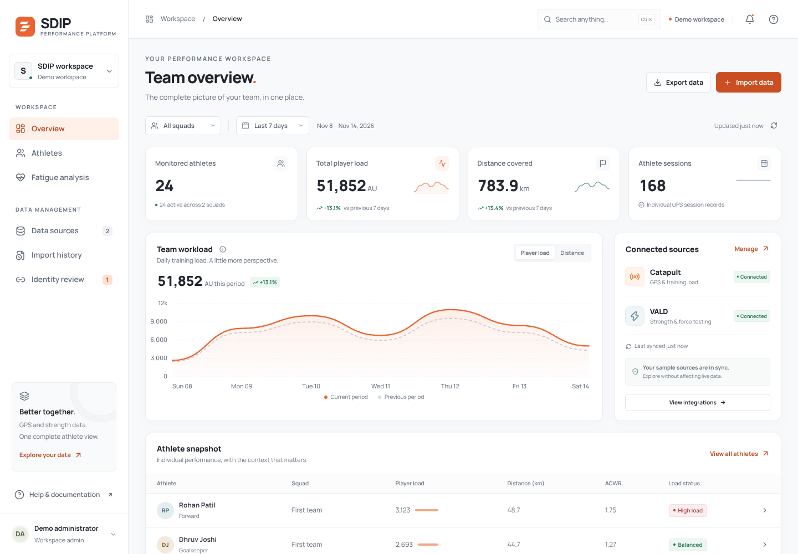
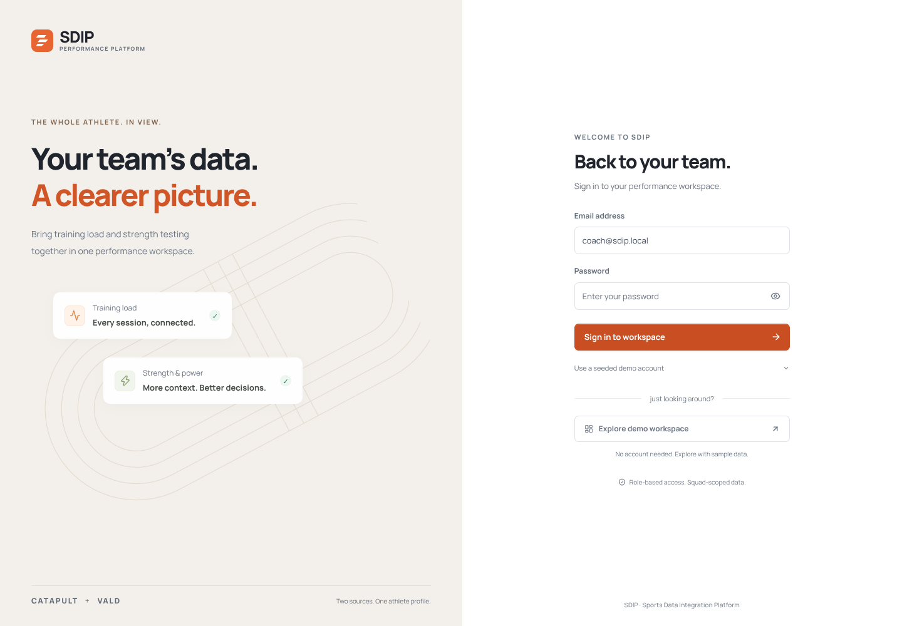
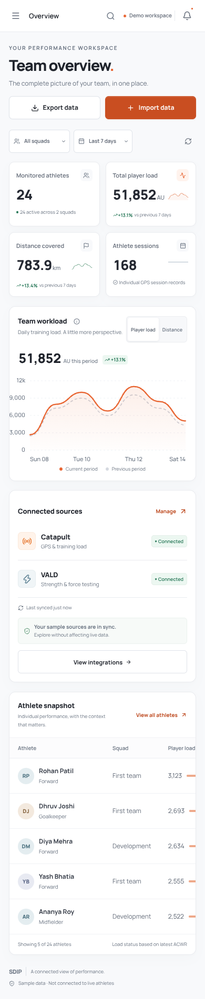

# SDIP — Sports Data Integration Platform


A modular-monolith integration platform that ingests athlete monitoring data
from **Catapult** (GPS microtechnology) and **VALD** (ForceDecks strength
testing), resolves cross-vendor athlete identities safely, and serves unified
longitudinal dashboards under strict role/tenant scoping.

Built as a capstone against four concrete problems:

| #   | Problem                                                            | How SDIP answers it                                                                                                                                                                              |
| --- | ------------------------------------------------------------------ | ------------------------------------------------------------------------------------------------------------------------------------------------------------------------------------------------ |
| C1  | Vendor exports arrive as messy CSV/XLSX with shifting column names | Streaming Spring Batch pipeline (OpenCSV + SAX XLSX) with declarative, admin-editable **column-mapping profiles** over a governed **metric dictionary** (units + aliases + range guards)         |
| C2  | The same athlete appears under different IDs in different systems  | **Tiered entity resolution** (deterministic → heuristic Jaro–Winkler/Double-Metaphone/DOB with conservative thresholds → human quarantine queue); **reversible** links, never destructive merges |
| C3  | Medical-adjacent data needs least-privilege access                 | Stateless **JWT RBAC** (4 roles) + **squad row-scoping** (Hibernate filter + explicit SQL restriction + 404 on cross-tenant by-id) + **AES-GCM-256** credential vault + **append-only audit**    |
| C4  | Vendor APIs throttle, fail, and send garbage                       | WebClient + Resilience4j (bounded retry/w/ jitter, circuit breaker, rate limiter), **watermark sync with 24–48h overlap**, watermark advances **only** on full success                           |

## Run it in 10 minutes

Docker is the only hard prerequisite.

```powershell
git clone https://github.com/Sehaan-1/sports-data-integration-platform.git
cd sports-data-integration-platform
docker compose up -d
```

Measured on a cold run (Windows 11, Docker 29.4.0, build cache pruned): **2 min 32 s**
from `docker compose up -d` to a healthy app, including a 2 min 11 s image build.
With a warm build cache the same command is ready in about a minute.

Then open <http://localhost:8080> and sign in.

The one-command demo builds the app image, starts PostgreSQL 16, applies
Flyway migrations, and seeds the demo dataset through the real ingestion
pipeline: 4 athletes, 7 Catapult GPS sessions (28 rows) and 12 VALD force tests
(12 rows).

### Demo sign-in (tenant `SDIP-DEMO`)

| User               | Password    | Role                | Squad scope |
| ------------------ | ----------- | ------------------- | ----------- |
| admin@sdip.local   | Admin#123   | ADMIN               | all         |
| coach@sdip.local   | Coach#123   | HEAD_COACH          | A Team      |
| physio@sdip.local  | Physio#123  | PRACTITIONER        | A Team      |
| analyst@sdip.local | Analyst#123 | ANALYST (read-only) | B Team      |

## Performance workspace

The frontend now includes a responsive sidebar workspace, squad/date filters,
keyboard-inspectable workload charts, a searchable athlete roster with profile
drawers, a two-axis load/ForceDecks view, source sync controls, import lineage,
and an identity-review queue. Import/export and administrator actions follow
the signed-in user's role; the server remains the authority for permissions.

The interface uses local Manrope/JetBrains Mono fonts and Lucide SVG icons.
It requires **no frontend build, CDN, or Node runtime in production**: Spring
Boot serves the HTML, CSS, and JavaScript modules directly from the jar.

### Screenshots

The overview below shows workload trends, source status, and the athlete
snapshot. All captures use the isolated sample workspace, not live athlete data.



<details>
<summary>Sign-in screen</summary>



</details>

<details>
<summary>Mobile overview</summary>



</details>

### Frontend-only preview

With Node 22 or later:

```sh
npm ci
npm run preview
```

Open <http://localhost:3000>. This explicitly opens an **isolated demo
workspace** with 24 synthetic athlete profiles. Demo imports, syncs, and
identity decisions only change in-memory browser fixtures; no vendor or live
API is contacted. Reloading resets those changes. Demo CSV previews support
files up to 10 MB; live CSV/XLSX uploads retain the backend's 150 MB limit.

For a real backend, use the normal Docker URL above, or run the preview with a
same-origin proxy (POSIX shell):

```sh
SDIP_API_URL=http://127.0.0.1:8080 npm run preview
```

The browser always uses relative `/api/...` URLs. The proxy is development-only;
there are no browser-facing localhost API calls and no fake HTTP API.

### Frontend checks

```sh
npm run test:frontend # Node tests: windows, scoping, ACWR, CSV, auth, preview
npm run test:browser  # Chromium: interactions, five widths, axe A/AA checks
```

The browser suite uses a pinned, npm-distributed Chromium, or `CHROME_PATH`
for an existing Chrome installation. Its production-path checks use a test-only
mock of the documented REST contracts; they do not replace the Java integration
tests. Reports and diagnostic captures stay under ignored `.cache/frontend-check`.
See [the frontend notes](docs/frontend.md) for design provenance and limitations.

## Architecture

Five Maven modules with hard package boundaries (domain → ingest/connectors/
security/api; ingest → api/connectors; security → ingest/connectors):

```
sdip-parent
├── sdip-core-domain     entities, repos, EntityLinker, MetricDictionary, UnitConverter,
│                         CanonicalImportService (idempotent upserts), AuditService,
│                         CredentialCryptoService, RowScopeGuard, Flyway V1+V2
├── sdip-ingestion       Spring Batch job: streaming CSV/XLSX readers → mapping/validation
│                         processor → bulk upsert writer; skip/quarantine of corrupt rows;
│                         batch bookkeeping; default mapping profiles
├── sdip-connectors      Catapult/VALD HTTP clients (WebClient), Resilience4j policies,
│                         watermark SyncOrchestrator, scheduled sync
├── sdip-security        JWT (HS256 access+refresh, rotation), security filter chain,
│                         squad-scope provider, seeded dev users
└── sdip-api             REST surface (athletes, ingestion, links/quarantine, connectors,
                         dashboards, exports, admin), static dashboard, pg profile
```

Stack: Java 21 LTS · Spring Boot 3.5 · Spring Batch 5.2 · PostgreSQL 16 · Flyway ·
POI + excel-streaming-reader (SAX) · OpenCSV · Spring Security 6 + JJWT ·
Resilience4j + WebClient · springdoc-openAPI · JUnit 5 + WireMock + MockMvc.

## API & RBAC

Interactive docs: `/swagger-ui.html`. Highlights:

| Endpoint                                                   | ADMIN |  HEAD_COACH  | PRACTITIONER |   ANALYST    |
| ---------------------------------------------------------- | :---: | :----------: | :----------: | :----------: |
| `POST /api/auth/login`, `/refresh`                         |  ✅   |      ✅      |      ✅      |      ✅      |
| `GET /api/athletes`, `/api/athletes/{id}`                  |  all  | squad-scoped | squad-scoped | squad-scoped |
| `GET /api/dashboard/**`                                    |  all  | squad-scoped | squad-scoped | squad-scoped |
| `POST /api/ingest/files` (upload)                          |  ✅   |      ✅      |      ✅      |     403      |
| `GET /api/ingest/batches[...]`                             |  ✅   |      ✅      |      ✅      |      ✅      |
| `POST /api/ingest/mapping-profiles`                        |  ✅   |     403      |     403      |     403      |
| `GET /api/exports/athletes.csv`                            |  ✅   |      ✅      |     403      |     403      |
| `/api/links/**` (quarantine portal, confirm/reject/unlink) |  ✅   |     403      |     403      |     403      |
| `/api/connectors/**` (manual sync, state)                  |  ✅   |     403      |     403      |     403      |
| `/api/admin/**` (users, audit, squads)                     |  ✅   |     403      |     403      |     403      |

Every mutating operation emits **exactly one** audit event
(`FILE_UPLOAD`, `LINK_CONFIRM`, `LINK_REJECT`, `LINK_UNLINK`,
`PERMISSION_CHANGE`, `EXPORT_DATA`, `CONNECTOR_SYNC[_FAILED]`,
`LOGIN`, `LOGIN_FAILED`, `TOKEN_REFRESH`, …).

## What's proven

Measured evaluation of the four requirements lives in
[docs/evaluation.md](docs/evaluation.md) — the RQ table with each row's exact
reproducing command and its caveat.

## Limits

- Restart-from-checkpoint for failed mid-file jobs is designed but not wired
  to the UI; lineage makes re-runs safe regardless.
- Fellegi–Sunter probabilistic tier (Tier 3) is a designed hook, not activated.
- The sandbox-grade evaluation runs on in-memory H2 + 2 vCPU; PostgreSQL numbers
  come from the Testcontainers-gated run.

## ADRs

- [ADR-01 — Modular monolith](docs/adr/ADR-01-modular-monolith.md)
- [ADR-02 — PostgreSQL aggregates-first](docs/adr/ADR-02-postgresql-aggregates-first.md)
- [ADR-03 — Sole frontend](docs/adr/ADR-03-sole-frontend.md)
- [ADR-04 — WebClient + Resilience4j](docs/adr/ADR-04-webclient-resilience4j.md)
- [ADR-05 — Java 21 + Boot 3.5.x](docs/adr/ADR-05-java21-boot35.md)
- [ADR-06 — Stateless JWT](docs/adr/ADR-06-stateless-jwt.md)

## License

MIT — see [LICENSE](LICENSE).
